<!--
  Profile README for github.com/mh-saeidi
  Visual assets live in ./assets and are generated by: python assets/src/build.py
-->

<p align="center">
  
</p>

<h1 align="center">MohammadHossein Saeidi</h1>

<p align="center">
  <code>Python Developer · IT Consultant · AI &amp; Intelligent Systems</code>
</p>

<p align="center">
  I build Python-based applications, backend systems and AI-powered tools. My background is in IT consulting,<br>
  and I have a hands-on interest in robotics and embedded systems.
</p>

<p align="center">
  <a href="https://github.com/mh-saeidi"></a>
  <a href="[site]"></a>
  <a href="[linkedin]"></a>
  <a href="[email]"></a>
</p>


### `01` &nbsp;Focus

| Backend engineering | Applied AI | IT systems &amp; infrastructure |
| :-- | :-- | :-- |
| Python services and APIs with FastAPI, SQL databases and clean, typed domain code. Maintainability first, then scale. | AI agents, conversational systems and RAG pipelines that work against real data and real users, not just demos. | Consulting on enterprise platforms, Linux administration and containerised deployment, with a growing focus on DevOps. |

<sub><b>Also:</b> computer vision, ROS and edge AI on embedded hardware, from autonomous-vehicle projects to on-device inference.</sub>

### `02` &nbsp;Selected work

<p>
  <a href="https://github.com/mh-saeidi/research-assistant"></a>
  <a href="https://github.com/mh-saeidi/ReID"></a>
</p>

<details>
<summary><b>Why the ReID project keeps four questions apart</b></summary>
<br>

Most "re-identification" systems quietly end up identifying outfits. This one separates the questions so that cannot happen:

| Question | Answered by |
| --- | --- |
| Is there a person here? | YOLO26 detection |
| Is this the same moving blob as last frame? | BoT-SORT tracking (temporary, source-local id) |
| Is a face visible, and how much of it? | SCRFD face detection, alignment and visibility scoring |
| Which registered person is this, if any? | Face embedding against the identity gallery |

The result is that a tracker id is never treated as an identity, `Unknown` is a first-class answer, and *no face* is reported as such instead of guessed from clothing. It also runs on NVIDIA Jetson for on-device inference.

</details>

<details>
<summary><b>How Research Assistant is put together</b></summary>
<br>

```text
SvelteKit + TypeScript UI  ──▶  Nginx  ──▶  FastAPI  ──▶  LangGraph agent  ──▶  LLM + tools
                                              │
                                              └──▶  PostgreSQL (SQLAlchemy) · research sessions
```

Services are split between backend and frontend, and the whole stack starts with a single `docker compose up`.

</details>

### `03` &nbsp;Stack

| | |
| :-- | :-- |
| **Core** |      |
| **AI** |      |
| **Infra** |     |
| **Edge** |   |
| **Also** |   |

### `04` &nbsp;How I work

<details>
<summary><b>A few principles</b></summary>
<br>

- **Solve the actual problem.** Consulting taught me to start from the operational need, not the technology.
- **Make failure states explicit.** A system that can say *unknown* is more useful than one that guesses confidently.
- **Ship the whole thing.** Code, data, containers and deployment are one deliverable.
- **Keep it boring where it counts.** Proven tools in the core, experiments at the edges.

</details>


<p align="center">
  <sub>Open to backend, applied-AI and IT-systems work. &nbsp;·&nbsp; <a href="[site]">Portfolio</a> &nbsp;·&nbsp; <a href="[email]">Email</a></sub>
</p>

<!--
  TODO before committing: replace the three placeholders below.
  The HTML links above use these labels as literal hrefs, so search-and-replace
  "[site]", "[linkedin]" and "[email]" with the real URLs.
    [site]     -> https://your-portfolio-domain
    [linkedin] -> https://www.linkedin.com/in/your-handle
    [email]    -> mailto:you@example.com
-->
